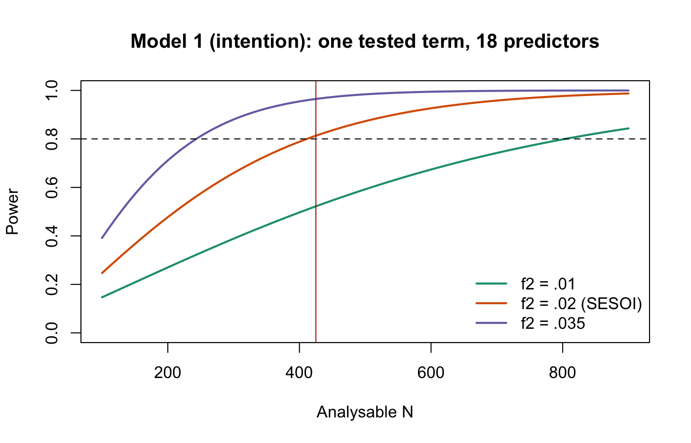
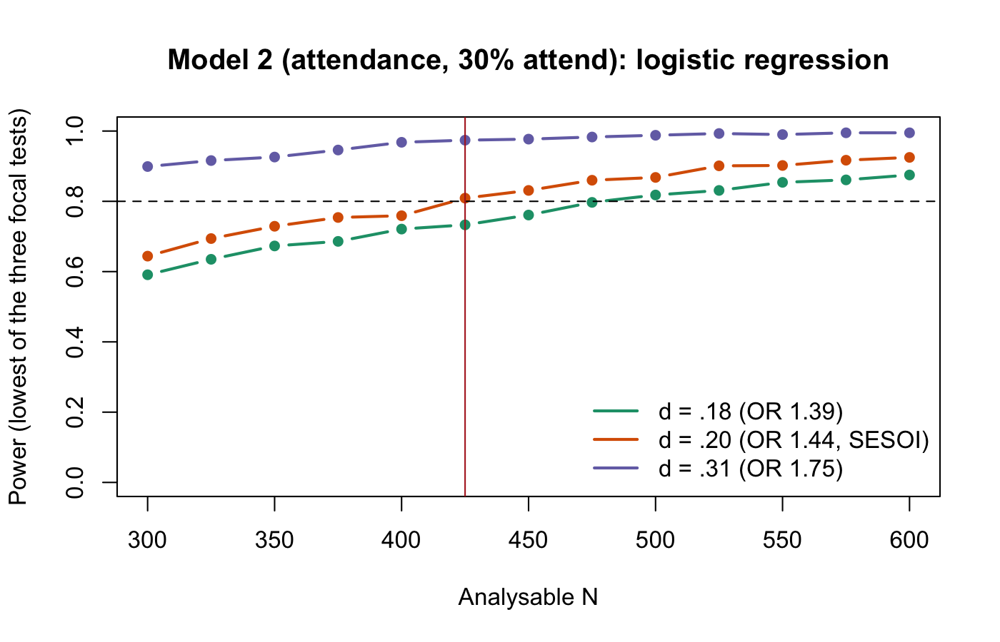

# Power Analysis Worksheet

Complete this worksheet for your primary (confirmatory) hypothesis, then attach it together with the output of your power-analysis script (R or Python) to your proposal or pre-registration. Example R scripts for common designs are in `scripts/` (see the Step 09 README).

> **Rule of thumb for this worksheet:** every number must have a source. If an effect size comes from a published study, give the citation and DOI and show how you converted it. If it is the smallest effect you care about, say why that size matters for your question.

*ESPM 231 Assignment 2 (RQ1 only), Isabela Tapia-Jaramillo. Everything for Step 09 is in this one document: the worksheet (sections 1–6), the full script output and power curves (section 5), and my sampling and pilot plan (section 7). The R code is the one separate file, [`power_analysis_rq1.R`](power_analysis_rq1.R), adapted from Step 09 example (e) Part A, plus a simulation for the logistic model; running it recreates everything in section 5.*

---

## 1. Study design

| Field | Your entry |
|---|---|
| Study title | Relational values, identity, trust and participation in giant tortoise conservation on Santa Cruz Island, Galápagos |
| Primary hypothesis (H1) | The template's "H1" means the main hypothesis the sample size is based on; in my study that is H3. **H3 (moderation):** trust in the GNPD strengthens the association between relational values and participation, tested as the RV × trust term in both models. The sample size also gives 80% power for the main effect of trust (H4) and, to be conservative, for the identity × trust term (exploratory). |
| Primary outcome and how it is measured | **Y1:** participation intentions (mean of 5 Likert items, 1–5). **Y2:** actual participation, i.e., attendance at a real community tortoise-monitoring day (0/1, sign-in sheet). |
| Design | ☐ Two groups, between subjects  ☐ BACI (before/after × control/impact)  ☐ ACI (after only, control/impact)  ☐ Within subjects  ☒ Other: **cross-sectional survey predicting outcomes from several variables (non-experimental), with a behavioral follow-up** |
| Statistical test for H1 | Model 1: *t*-test of one regression coefficient in a linear regression with 18 predictors. Model 2: Wald test of one coefficient in a logistic regression with the same 18 predictors. |
| Unit of analysis (person, household, site…) | Person (adult resident) |
| Allocation ratio (e.g., 1:1) | Not applicable (no groups assigned) |
| Software and script used | ☒ R  ☐ Python  ☐ G*Power  ☐ Other: |
| Script file name | `power_analysis_rq1.R` (R 4.5.2; `pwr` 1.3.0; `MASS` 7.3-65) |

---

## 2. Assumed effect size

| Field | Your entry |
|---|---|
| Effect size metric | ☐ Cohen's d  ☒ Cohen's f (**f²** for Model 1)  ☐ Correlation r  ☒ Odds ratio / two proportions (**OR per SD** for Model 2)  ☐ Other: |
| Assumed value | **f² = .02** for one tested term (Model 1); **OR = 1.44** per SD of a predictor (Model 2) |
| Source (author, year, journal) | **Smallest effect size of interest (SESOI):** Cohen's (1988) "small" effect (d = .20; f² = .02). Sensitivity values from Bergquist, Thiel, Goldberg and van der Linden (2023), *PNAS*: d = .31 (average effect of field interventions on climate-mitigation behaviors) and d = .18 (after correcting for publication bias). |
| DOI | Bergquist et al. (2023): https://doi.org/10.1073/pnas.2214851120 · Chinn (2000), conversion: https://doi.org/10.1002/1097-0258(20001130)19:22<3127::AID-SIM784>3.0.CO;2-M |
| Statistic reported in the source (e.g., means and SDs, t, F, r) | Bergquist et al. (2023) report pooled Cohen's d (0.31 average; 0.18 bias-corrected). Cohen (1988) defines d = .20 and f² = .02 as "small". |
| How you converted it to your metric (formula) | **d → OR** (Chinn, 2000): ln(OR) = d × π / √3 → d = .18 → OR = 1.39; d = .20 → OR = 1.44; d = .31 → OR = 1.75. Model 1 uses f² = .02 directly. |
| Smallest effect size of interest (SESOI) and why it matters | **d = .20 / f² = .02.** A smaller association between trust (or RV and identity) and participation would be too weak to justify changing how the GNPD and local partners engage residents. A "small" effect is also the usual floor in conservation-psychology survey research, where one predictor's unique contribution is typically small because predictors overlap (Step 09 example e, section 1). |
| Why you did not rely on a pilot-study estimate alone | Pilot studies (here, 30 residents) give very imprecise effect sizes. The pilot is used to test procedures, timing and scale reliability, and to check the assumed correlation among predictors and non-response. The pilot measures sign-up for the monitoring day (no day is held), which overstates attendance. After the pilot, the power analysis is re-run; the sign-up rate replaces the assumed 30% only if it is lower, and **final recruitment = 450 or the updated N, whichever is larger.** |

**Other inputs (assumptions, with source):**
- **Expected attendance = 30%.** My estimate, based on my experience working in conservation in the Galápagos and as a resident. The pilot measures sign-up only (an upper bound on attendance), so it can lower but not raise this assumption. Free transport, food and family activities lower barriers, but work and family commitments remain.
- **Correlation among identity, trust and RV = .30.** Assumption, to be checked in the pilot.
- **18 predictors:** 5 focal terms (identity, trust, RV, RV × trust, identity × trust) and 13 covariates (area; origin; occupation with 7 categories = 6 dummies; age; gender; education; years in Galápagos; barrier count).

*Tip: pilot studies are too small to estimate an effect size precisely. Use them to test procedures, completion time, and the reliability of your measures; base the effect size on published evidence or on your smallest effect size of interest.*

---

## 3. Error rates and inflation for attrition

| Field | Your entry |
|---|---|
| Alpha (Type I error rate) | .05 |
| One- or two-sided test | ☒ Two-sided  ☐ One-sided (justify below) |
| Target power (1 − β) | .80 |
| Required N from the power analysis (per group) | Not applicable (no groups) |
| Required N from the power analysis (total) | **Model 1:** 412 (`pwr.f2.test`: v = 392.4; N = v + k + 1). **Model 2:** 425 (smallest N in the simulation grid with power ≥ .80 for all three focal tests at OR = 1.44; 1,000 simulations per cell). **Analysable N = 425.** |
| Expected attrition between waves (%) and source | Not applicable: one survey. Monitoring-day attendance is the outcome itself, not attrition. |
| Expected non-response / exclusions (%) and source | 5%: incomplete surveys and failing both attention checks in a face-to-face tablet survey (assumption, to be updated from the pilot) |
| Inflated N to recruit = N ÷ ((1 − attrition) × (1 − non-response)) | 425 ÷ (1 × 0.95) = 447.4 → **recruit 450** (about 19 field days with 3 enumerators at ~8 surveys/day) |

Justification for any non-default choice (e.g., one-sided test, alpha other than .05, power other than .80):

No non-default choices: two-sided tests, α = .05, power = .80.

---

## 4. Sensitivity analysis

Report the sample size your design needs across a plausible range of effect sizes, or the smallest effect your feasible N can detect.

| Assumed effect size | Required N per group | Required N total | Notes |
|---|---|---|---|
| Model 1, f² = .01 | n/a | 804 | Very small unique effect |
| Model 1, **f² = .02 (SESOI)** | n/a | **412** | |
| Model 1, f² = .035 | n/a | 244 | |
| Model 2, d = .18 (OR 1.39; bias-corrected, Bergquist et al., 2023) | n/a | ≈ 475 | Power at N = 425: **.73** (reported as a limitation) |
| Model 2, **d = .20 (OR 1.44; SESOI)** | n/a | **425** | Power at N = 425: .81 |
| Model 2, d = .31 (OR 1.75; average, Bergquist et al., 2023) | n/a | < 300 | Power at N = 425: .97 |

Smallest effect detectable with the N you can realistically recruit (at your alpha and power): with N = 425, Model 1 detects **f² ≈ .019** for one term; Model 2 detects about **OR = 1.44** (d ≈ .20); the intention–behavior correlation detects **r = .14**.

---

## 5. Script output

Paste the key lines printed by your script (or attach the full output as a separate page).

```
R version 4.5.2 (2025-10-31) | pwr 1.3.0 | MASS 7.3.65
alpha = 0.05 (two-sided) | power = 0.80 | k = 18 predictors
SESOI: f2 = 0.02 (intention); d = 0.20 -> OR = 1.44 per SD (behavior)
Attendance = 30% | r among focal predictors = 0.30 | non-response = 5%

=== Model 1: intention (pwr.f2.test, one tested term) ===
f2 = 0.02, u = 1, k = 18 -> v = 392.4 -> N = 412

=== Model 2: behavior (logistic; 1000 simulations per cell) ===
Smallest N in the grid with power >= 0.80 for ALL three focal tests at the SESOI (OR = 1.44): 425

=== Y1-Y2 correlation (point-biserial) ===
Smallest correlation detectable with N = 425: r = 0.14

=== Sample size decision ===
Intention model needs 412; behavior model needs 425 -> analysable N = 425
Recruit N = 425 / (1 - 0.05) = 450 (rounded up to a multiple of 5)
Field effort: 3 enumerators x ~8 surveys/day -> ~19 field days
Behavior model, lowest focal power at N = 425: d = .18 -> 0.73 | d = .20 -> 0.81 | d = .31 -> 0.97
```

**Full output**, including the simulation table for the attendance model (power for each focal test at each sample size):

<details>
<summary>Click to show the full output</summary>

```
R version: R version 4.5.2 (2025-10-31) | pwr 1.3.0 | MASS 7.3.65 

=== Assumptions ===
alpha = 0.05 (two-sided) | power = 0.80 | k = 18 predictors
SESOI: f2 = 0.02 (intention); d = 0.20 -> OR = 1.44 per SD (behavior)
Attendance = 30% | r among focal predictors = 0.30 | non-response = 5%

=== Model 1: intention (pwr.f2.test, one tested term) ===
f2 = 0.02, u = 1, k = 18 -> v = 392.4 -> N = 412
Sensitivity (f2 for one term -> N):
    f2   N
 0.010 804
 0.020 412
 0.035 244
 0.050 176

=== Model 2: behavior (logistic; 1000 simulations per cell) ===
 effect   OR   N trust rv_x_trust id_x_trust min_power
  d_018 1.39 300  0.62       0.61       0.59      0.59
  d_018 1.39 325  0.65       0.66       0.64      0.64
  d_018 1.39 350  0.67       0.68       0.69      0.67
  d_018 1.39 375  0.70       0.73       0.69      0.69
  d_018 1.39 400  0.72       0.73       0.72      0.72
  d_018 1.39 425  0.74       0.79       0.73      0.73
  d_018 1.39 450  0.79       0.76       0.78      0.76
  d_018 1.39 475  0.82       0.83       0.80      0.80
  d_018 1.39 500  0.83       0.83       0.82      0.82
  d_018 1.39 525  0.83       0.86       0.84      0.83
  d_018 1.39 550  0.85       0.86       0.88      0.85
  d_018 1.39 575  0.88       0.86       0.88      0.86
  d_018 1.39 600  0.88       0.88       0.88      0.88
  d_020 1.44 300  0.71       0.64       0.68      0.64
  d_020 1.44 325  0.72       0.69       0.72      0.69
  d_020 1.44 350  0.75       0.73       0.75      0.73
  d_020 1.44 375  0.78       0.75       0.77      0.75
  d_020 1.44 400  0.81       0.80       0.76      0.76
  d_020 1.44 425  0.83       0.82       0.81      0.81
  d_020 1.44 450  0.86       0.83       0.86      0.83
  d_020 1.44 475  0.87       0.86       0.86      0.86
  d_020 1.44 500  0.87       0.89       0.88      0.87
  d_020 1.44 525  0.90       0.92       0.91      0.90
  d_020 1.44 550  0.91       0.90       0.91      0.90
  d_020 1.44 575  0.92       0.93       0.92      0.92
  d_020 1.44 600  0.92       0.93       0.94      0.92
  d_031 1.75 300  0.94       0.91       0.90      0.90
  d_031 1.75 325  0.94       0.93       0.92      0.92
  d_031 1.75 350  0.97       0.94       0.93      0.93
  d_031 1.75 375  0.98       0.96       0.95      0.95
  d_031 1.75 400  0.98       0.97       0.97      0.97
  d_031 1.75 425  0.98       0.98       0.97      0.97
  d_031 1.75 450  0.98       0.98       0.98      0.98
  d_031 1.75 475  0.99       0.99       0.98      0.98
  d_031 1.75 500  0.99       0.99       0.99      0.99
  d_031 1.75 525  1.00       1.00       0.99      0.99
  d_031 1.75 550  1.00       1.00       0.99      0.99
  d_031 1.75 575  1.00       1.00       1.00      1.00
  d_031 1.75 600  1.00       1.00       1.00      1.00

Smallest N in the grid with power >= 0.80 for ALL three focal tests at the SESOI (OR = 1.44): 425

=== Y1-Y2 correlation (point-biserial) ===
Smallest correlation detectable with N = 425: r = 0.14

=== Sample size decision ===
Intention model needs 412; behavior model needs 425 -> analysable N = 425
Recruit N = 425 / (1 - 0.05) = 450 (rounded up to a multiple of 5)
Field effort: 3 enumerators x ~8 surveys/day -> ~19 field days
Behavior model, lowest focal power at N = 425: d = .18 -> 0.73 | d = .20 -> 0.81 | d = .31 -> 0.97

Power curves saved to ESPM231_Assignment2_RQ1/Step09_power/output
```

</details>

**Power curves**





---

## 6. Checklist before you attach this worksheet

- [x] The effect size has a real, checkable source (citation and DOI), or a stated smallest effect size of interest.
- [x] I showed how a reported statistic was converted to d, f, or r. *(d → OR with Chinn, 2000)*
- [x] Alpha, sidedness, and power are stated and justified.
- [x] The recruited N is inflated for attrition and non-response. *(No attrition in a one-survey design; 5% non-response.)*
- [x] A sensitivity analysis shows how N changes across plausible effect sizes.
- [x] The script and its output are attached, with the package versions printed by the script.

---

## 7. Sampling and pilot plan

*Step 09 also covers sampling and pilots but has no template for them, so I added this section to the worksheet.*

### 7.1 Target population and inferential goal

- **Population:** adults (18+) who live on Santa Cruz Island: Puerto Ayora and the highland parishes of Bellavista and Santa Rosa.
- **Goal:** test hypotheses about how relational values, identity and trust predict intentions and participation, and describe differences between groups (Step 01). There is no complete public list of residents, so the study uses **non-probability quota sampling**. Results describe the groups sampled, not the whole island, and this is stated openly.

### 7.2 Quotas

| Quota dimension | Levels |
|---|---|
| Area | Puerto Ayora vs. highlands (Bellavista + Santa Rosa) |
| Occupation | Farming · fishing · tourism · naturalist guide · conservation & research · education & public services · other |
| Origin | Born in Galápagos vs. born outside Galápagos. Residents born in another country are grouped with those born on mainland Ecuador; the country of birth is still recorded, and the number born abroad is reported. |

Quota targets are set in proportion to the most recent Galápagos census and adjusted after the pilot. There is no minimum per occupation: occupation is a control variable, not a group being compared. Any occupation with fewer than 10 people in the final sample is merged with the most similar category before the main analysis (e.g., naturalist guide into tourism), and the final count for each occupation is reported. Occupation is classified by the **type of work**, not the employer, so teachers in public and private schools are both in "education & public services". GNPD employees are flagged with a separate question.

### 7.3 Recruitment

Three trained local enumerators recruit through:
- **Puerto Ayora:** door to door in **randomly chosen blocks** (drawn in R with a recorded seed from the municipal block map; one adult per household);
- **Highlands:** door to door **along highland roads**;
- **Associations:** **farmers' and fishers' associations**; and **schools**, including the two private schools, to fill the education quota if needed.

Visits include evenings and weekends, so people with long working hours can take part. Refusals and non-contacts are recorded by quota group so response rates can be reported. At ~8 surveys per enumerator per day, 450 surveys take **about 19 field days**.

**Known biases (limitations):**
- Association members and people at home may be over-represented.
- Residents who distrust institutions may be more likely to refuse. To reduce this, consent stresses that the team is independent of the GNPD.

### 7.4 Pilot plan

| Stage | n | What is checked | Decision rules |
|---|---|---|---|
| **Translation** | n/a | Forward translation and independent back-translation (Brislin, 1970) | Items whose meaning changes are revised and translated again |
| **Cognitive interviews** | **8** residents across quota groups | Think-aloud and verbal probing (Willis, 2005): the meaning of "Galapagueño/a"; trust items for people with little GNPD contact; long relational-values items; attention checks as comprehension aids; the occupation categories; the order of the open question | An item misunderstood by 2 or more of the 8 people is revised and retested |
| **Pilot survey** | **30** residents, not in the main sample | Completion time per block; item non-response; attention-check pass rate; **reliability (Cronbach's α and McDonald's ω)** for RV, ID, TRUST and INT, as a rough check (30 people is too few for factor analysis); correlation among identity, trust and RV (assumed .30); **sign-up rate** for the monitoring day. The pilot ends with the monitoring-day invitation and sign-up, but no monitoring day is held, so attendance itself is not piloted. | Keep a scale if α or ω ≥ .70; items that lower α are flagged for review. Cut items if a block runs > 25% over time. **Re-run `power_analysis_rq1.R`** with the pilot's predictor correlation and non-response. Sign-up overstates attendance, so the pilot sign-up rate replaces the assumed 30% attendance only if it is lower. **Final recruitment = 450 or the updated N, whichever is larger.** |

**Factor structure is tested in the main sample.** Confirmatory factor analysis (CFA) needs far more than 30 people, so it is run on the main sample (N ≈ 425) before hypothesis testing. Items with loadings < .40 are dropped, and any dropped item is reported.

---

### References

Bergquist, M., Thiel, M., Goldberg, M. H., & van der Linden, S. (2023). Field interventions for climate change mitigation behaviors: A second-order meta-analysis. *Proceedings of the National Academy of Sciences*, *120*(13), e2214851120. https://doi.org/10.1073/pnas.2214851120

Brislin, R. W. (1970). Back-translation for cross-cultural research. *Journal of Cross-Cultural Psychology*, *1*(3), 185–216. https://doi.org/10.1177/135910457000100301

Chinn, S. (2000). A simple method for converting an odds ratio to effect size for use in meta-analysis. *Statistics in Medicine*, *19*(22), 3127–3131. https://doi.org/10.1002/1097-0258(20001130)19:22<3127::AID-SIM784>3.0.CO;2-M

Cohen, J. (1988). *Statistical power analysis for the behavioral sciences* (2nd ed.). Lawrence Erlbaum.

Willis, G. B. (2005). *Cognitive interviewing: A tool for improving questionnaire design*. SAGE.

*Cross-reference: [`../Step04_design/design_decision_matrix.md`](../Step04_design/design_decision_matrix.md)*
